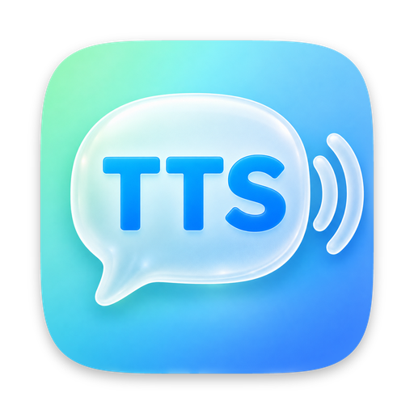
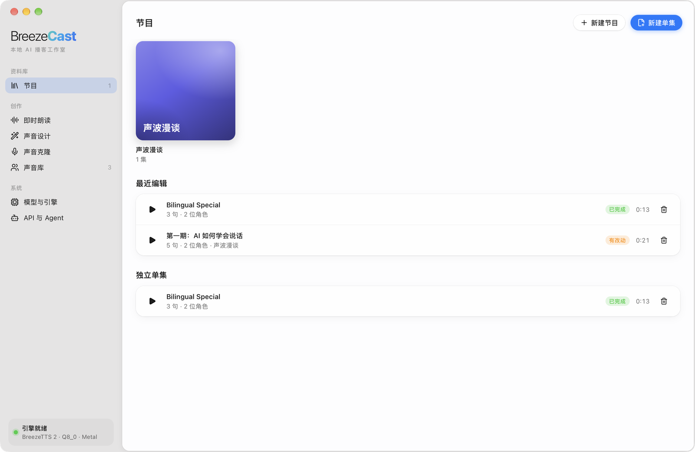
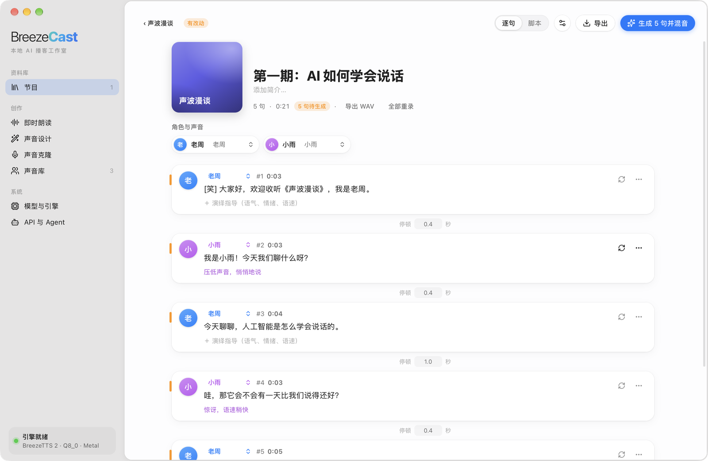
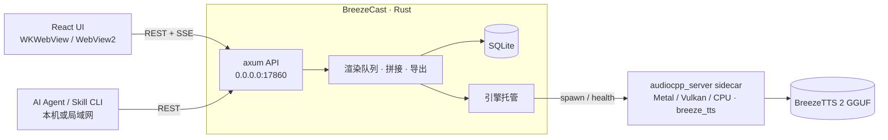

<div align="center">



# BreezeCast

**完全在本机运行的 AI 播客工作室**

写一份多角色脚本，用 [BreezeTTS 2](https://huggingface.co/BreezeBlue/Breeze-TTS-2) 生成整期播客：设计声音、克隆声音、逐句指导演绎，最后导出带字幕和章节的音频。


[功能](#-功能) · [快速开始](#-快速开始) · [使用指南](#-使用指南) · [API 与 Agent](#-api-与-agent) · [架构](#-架构) · [许可](#-许可)

</div>

---

## BreezeCast 是什么

BreezeCast 是一个 macOS / Windows 桌面应用，把开源语音模型 BreezeTTS 2 包装成一套完整的播客制作工具：

- **离线运行**：模型通过 [audio.cpp](https://github.com/0xShug0/audio.cpp)（ggml，macOS 用 Metal，Windows 用 Vulkan 或 CPU）在你的电脑上推理，文本和声音不会上传到任何服务器。
- **面向整期节目**：不只是“输入一句话、得到一段音频”。你可以管理节目和单集，用脚本编排多位主持人的对话，单独修改某一句并只重新生成这一句，最后自动混音导出。
- **为 AI Agent 设计**：界面的每一项功能都通过本地 REST API 开放。Claude Code、Codex 等 Agent 安装配套 Skill 后，可以直接替你写稿、选声音、生成和导出播客。

适合想做中文/英文播客、有声内容、配音样片，或者想让 AI Agent 自动产出音频内容的个人创作者和开发者。

## 📸 截图

<p align="center">
  
  
</p>
<p align="center"><sub>左：节目库，管理节目和单集　·　右：单集编辑器，逐句编辑台词、角色和演绎指导</sub></p>

## ✨ 功能

| 模块 | 能做什么 |
|---|---|
| **节目 / 单集编辑器** | 用脚本写多角色对谈；逐句编辑台词、演绎指导、停顿和声音事件；逐句换一条或锁定随机种子；只重新生成改动过的句子；自动响度统一并混音；导出 M4A / WAV、SRT 字幕、章节 JSON 和文稿 |
| **即时朗读** | 实时流式播放（M5 芯片上首包约 0.2–1 秒）或整段生成；可调全部采样参数；历史里任意一条都能存为声音 |
| **声音设计** | 用一段文字描述创造全新的声音，或用属性标签组合描述；一次生成多个候选，挑最满意的保存为固定音色 |
| **声音克隆** | 跟读录音（逐字稿自动填入）或导入 WAV / MP3 / M4A / AIFF / FLAC / OGG；保存前先试听克隆效果；需确认已获本人授权 |
| **声音库** | 管理参考音频、默认演绎指导和声音级参数；输入一句指导即可试听 |
| **模型与引擎** | Q4_0 / Q4_K / Q8_0 / BF16 四种精度一键下载（断点续传、SHA-256 校验）和切换；BF16 参考精度开关；常驻内存设置；引擎日志 |
| **API 与 Agent** | 启动即开启的 REST API，局域网内其他设备可直接调用；自动发现文件；一键把 Skill 安装到 Claude Code / Codex / oh-my-pi |

支持的声音事件：中文 `[笑]` `[叹气]` `[咳嗽]` `[清嗓子]`，英文 `(laugh)` `(sigh)` `(cough)` `(clears throat)`。支持中英文混合文本。

## 💻 系统要求

| 项目 | macOS | Windows |
|---|---|---|
| 系统 | macOS 14 Sonoma 或更高；macOS 26+ 会显示 Liquid Glass 风格图标 | Windows 10 1903 或更高 / Windows 11，x64 |
| 推理 | Apple Silicon（M1 及以后），Metal | 有 Vulkan 驱动的显卡（NVIDIA / AMD / Intel）走 Vulkan，否则自动退回 CPU（明显更慢） |
| 内存 | 建议 16 GB 及以上（Q8_0 模型加载后约占 3.7 GB） | 同左；用 Vulkan 时显存建议 6 GB 及以上 |
| 磁盘 | 每个模型 3.8–7.3 GB，见下表 | 同左 |

| 模型 | 大小 | 说明 |
|---|---|---|
| Q4_0 | 3.8 GB | 体积最小 |
| Q4_K | 4.5 GB | 体积和质量的折中 |
| **Q8_0** | **5.1 GB** | **默认推荐** |
| BF16 | 7.3 GB | 参考精度 |

Windows 上导出 M4A 依赖系统自带的 Media Foundation；Windows N / KN 版需先安装“媒体功能包”，否则只能导出 WAV。

## 🚀 快速开始

预编译安装包在 [Releases](https://github.com/linyqh/BreezeCast/releases)：macOS 下载 `.dmg`（已签名并公证），Windows 下载 `*-setup.exe`（未签名，SmartScreen 拦截时点“更多信息 → 仍要运行”）。

下面是从源码构建的步骤。

**1. 准备环境**

- 通用：[Rust](https://rustup.rs)、Node.js 22+、[pnpm](https://pnpm.io)
- macOS：Xcode Command Line Tools。没有 cmake 时，构建脚本会自动在 `.tools/` 下安装一份。
- Windows：Visual Studio 2022 Build Tools（“使用 C++ 的桌面开发”）、[Vulkan SDK](https://vulkan.lunarg.com)（安装后设置 `VULKAN_SDK`）、Git

**2. 构建并运行**

```bash
git clone https://github.com/linyqh/BreezeCast.git
cd BreezeCast
pnpm install
scripts/build-engine.sh        # macOS：编译 audio.cpp 推理引擎（Metal，只含 breeze_tts）
pnpm tauri dev                 # 开发模式运行
```

Windows 在 PowerShell 中把第 4 行换成：

```powershell
.\scripts\build-engine.ps1     # Vulkan 版（含 CPU 后备）；没有 Vulkan SDK 时加 -Backend cpu
```

打包：

```bash
pnpm tauri build               # macOS 产出 .app / .dmg，Windows 产出 NSIS 安装包；位于 src-tauri/target/release/bundle/
```

audio.cpp 的版本固定在 `scripts/audiocpp.rev`，两个平台的构建脚本在 `vendor/audio.cpp` 不存在时都按这个提交拉取。

**3. 下载模型**

第一次启动后，进入侧边栏的“模型与引擎”，下载一个模型（推荐 Q8_0）。下载完成、引擎显示“引擎就绪”后即可使用。

### 发布新版本

Windows 安装包在 GitHub Actions 上构建（`.github/workflows/release-windows.yml`），macOS 安装包在本地构建后上传，两者进同一个 Release：

1. 修改 `src-tauri/tauri.conf.json`、`package.json` 和 `src-tauri/Cargo.toml` 里的版本号并提交。
2. 打 tag 并推送：`git tag v0.2.0 && git push origin main v0.2.0`。CI 会编译 Windows 引擎、跑 Rust 测试、打出 `BreezeCast_0.2.0_x64-setup.exe`，并上传到 `v0.2.0` 的 Release（不存在就建一个草稿）。tag 必须和 `tauri.conf.json` 的版本一致，否则 CI 直接失败。
3. 在 Mac 上运行 `scripts/release-macos.sh`：构建 `.dmg` 并上传到同一个 Release。加 `--skip-build` 只上传已有产物，加 `--publish` 在上传后把草稿发布出去。

也可以在 Actions 页面手动运行 `release-windows`：填 tag 就上传到对应 Release，留空只生成可下载的 artifact。

## 📖 使用指南

### 用脚本写一期节目

在“节目”里新建单集，粘贴类似下面的脚本：

```text
# 第 1 期：声音的故事
主持人: [笑] 欢迎收听《声波漫谈》。
嘉宾 {轻声，带点犹豫}: 嗯……其实我一开始也不太确定。
<pause 1.5s>
Host {excited, fast}: (laugh) That's amazing!
```

| 语法 | 含义 |
|---|---|
| `角色: 台词` | 一句台词，冒号可用 `:` 或 `：` |
| `角色 {指导}: 台词` | 给这一句单独加演绎指导（语气、情绪、语速） |
| `<pause 1.5s>` / `<pause 800ms>` | 单独一行，在上一句之后插入静音 |
| 没有角色前缀的行 | 接着上一位角色继续说 |
| `# 标题` | 井号加空格开头的行是标题或注释，不会朗读 |

然后为每个角色分配声音库里的音色，点击生成。之后修改任意一句，只会重新生成这一句。

### 创造或克隆一个声音

- **声音设计**：写一段描述，例如“一位声音温暖、语速偏慢的中年男性电台主持人”，生成几个候选后保存最满意的那个。
- **声音克隆**：录一段 3–20 秒的清晰人声，或导入音频文件并提供准确的逐字稿。克隆他人声音前必须取得本人授权。

## 🤖 API 与 Agent

BreezeCast 的界面本身就是通过本地 REST API 工作的，所以 Agent 能做到界面能做的一切。

- 本机地址：`http://127.0.0.1:17860`（端口可在应用内修改）；局域网地址显示在“API 与 Agent”页。
- 运行中的应用会写入 `~/Library/Application Support/com.breezecast.studio/api.json`，本机的 Agent 可以自动找到它。
- 完整接口文档见 [docs/API.md](docs/API.md)；运行时也可以访问 `GET /api/v1/capabilities` 获取机器可读的能力说明。

### 安装 Skill

在应用的“API 与 Agent”页点击“安装”，或者运行：

```bash
scripts/install-skills.sh              # 为 Claude Code / Codex / oh-my-pi 创建软链接
scripts/install-skills.sh --uninstall  # 移除
```

Skill 位于 [skills/breezecast](skills/breezecast/SKILL.md)，自带一个零依赖的 Python 命令行工具：

```bash
BC="python3 skills/breezecast/scripts/breezecast.py"
$BC status
$BC episode-create --title "第 1 期" --script-file ep.txt --cast '主持人=老周'
$BC render e_xxx --wait
$BC export e_xxx --format m4a
```

> [!WARNING]
> API 不做鉴权，并且监听所有网卡：同一局域网内的任何人都能调用全部接口，包括删除数据和导出文件到任意目录。请只在可信网络中运行 BreezeCast。

## 🏗 架构



- **前端**：React + TypeScript + Vite，运行在 Tauri 的 WebView 中（macOS 为 WKWebView，Windows 为 WebView2），界面按 macOS 原生风格设计（悬浮玻璃侧边栏、系统强调色、浅色/深色模式）；Windows 上使用原生标题栏和不透明背景。
- **后端**：Rust（Tauri 2 + axum），负责 API、渲染队列、音频拼接混音和导出，数据存在 SQLite。
- **推理引擎**：audio.cpp 编译的 `audiocpp_server`，作为 sidecar 子进程运行。一个 streaming 会话同时处理流式和整段请求，模型只占一份内存。macOS 固定使用 Metal；Windows 启动时用 `--list-devices` 探测，优先 CUDA / Vulkan 显卡，没有就用 CPU。
- **数据目录**：macOS 为 `~/Library/Application Support/com.breezecast.studio/`，Windows 为 `%APPDATA%\com.breezecast.studio\`，包括模型、声音、片段、单集、SQLite 数据库和 `api.json`。

### 目录结构

```text
src/                 React 前端
src-tauri/           Rust 后端与 Tauri 配置
  icons/             应用图标（macOS .icon / .icns，Windows .ico）
skills/breezecast/   Agent Skill 与命令行工具
scripts/             引擎构建（.sh / .ps1）、macOS 发布、图标编译、Skill 安装脚本
.github/workflows/   Windows 云端打包
docs/API.md          REST API 文档
```

### 应用图标

macOS 26+ 使用由 `src-tauri/icons/AppIcon.icon`（Liquid Glass）预编译的 `Assets.car`，更早的 macOS 使用 `icon.icns`，Windows 使用 `icon.ico` 和 `Square*Logo.png`。修改 `AppIcon.icon` 后运行 `scripts/build-icon.sh` 重新生成 `Assets.car`。

## 📄 许可

- **模型与生成的音频**：BreezeTTS 2 的模型权重以及用它在本地生成的所有音频，都受 [BreezeBlue Research and Non-Commercial License](https://huggingface.co/BreezeBlue/Breeze-TTS-2/blob/main/LICENSE) 约束，**仅限研究和非商业用途**。
- **第三方代码**：推理引擎 [audio.cpp](https://github.com/0xShug0/audio.cpp) 使用 Apache-2.0 许可。
- **本项目代码**：[MIT License](LICENSE)。
- **声音克隆**：克隆他人声音前必须取得本人授权，请勿用于冒充、欺诈或其他违法用途。

## 🙏 致谢

- [BreezeTTS 2](https://huggingface.co/BreezeBlue/Breeze-TTS-2)：BreezeBlue 发布的中英双语语音模型
- [audio.cpp](https://github.com/0xShug0/audio.cpp)：基于 ggml 的本地音频模型推理
- [Tauri](https://tauri.app)：跨平台桌面应用框架
