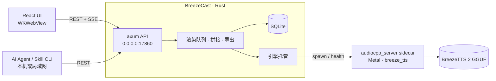

# BreezeCast

本地运行的 AI 播客工作室：Tauri 2 桌面客户端 + [audio.cpp](https://github.com/0xShug0/audio.cpp)（ggml / Metal）+ [BreezeTTS 2](https://huggingface.co/BreezeBlue/Breeze-TTS-2)。界面按 macOS 原生风格设计（悬浮玻璃侧边栏、系统强调色、浅色/深色模式），所有能力同时通过 REST API（本机和局域网）开放给 AI Agent，并附带配套 Skill。

## 功能

| 模块 | BreezeTTS 2 能力 |
|---|---|
| 节目 / 单集编辑器 | 用脚本写多角色对谈；逐句编辑台词、演绎指导（Voice Direction）、停顿和声音事件；逐句换条或锁定种子；只重新生成改动过的句子；自动响度统一并混音；导出 M4A/WAV、SRT 字幕、章节 JSON 和文稿 |
| 即时朗读 | 实时流式播放（M5 上首包约 0.2–1 秒）或整段生成；支持全部采样参数；历史里任意一条都能存为声音 |
| 声音设计 | 用文字描述创造声音（Voice Design）；用属性标签组合描述；一次生成多个候选，把最满意的保存下来作为固定音色 |
| 声音克隆 | 跟读录音（逐字稿自动填入）或导入 WAV/MP3/M4A/AIFF/FLAC；保存前可以先试听克隆效果；有授权确认 |
| 声音库 | 参考音频、默认指导、声音级参数；可以输入一句指导直接试听 |
| 模型与引擎 | Q4_0 / Q4_K / Q8_0 / BF16 四种 GGUF 一键下载（支持断点续传、SHA-256 校验）和切换；Metal BF16 参考精度开关；常驻内存设置；全局默认参数；引擎日志 |
| API 与 Agent | REST API，启动即开启，无需鉴权，局域网内其他设备可直接访问；自动发现文件；一键把 Skill 安装到 Claude Code / Codex / oh-my-pi |

声音事件：中文 `[笑] [叹气] [咳嗽] [清嗓子]`，英文 `(laugh) (sigh) (cough) (clears throat)`。

## 架构



- 界面只通过 REST API 工作，所以 Agent 能做到界面能做的一切。
- 引擎是一个 `streaming` 会话，同时处理流式和整段请求，模型只占一份内存（Q8_0 在 Metal 上约 3.7 GB）。
- 数据目录：`~/Library/Application Support/com.breezecast.studio/`（模型、声音、片段、单集、SQLite、`api.json`）。
- API 不做鉴权、监听所有网卡：同一局域网内任何人都能调用全部接口（包括删除和导出到任意目录），请只在可信网络中运行。

## 开发

需要 Rust、Node 22+、pnpm 和 Xcode Command Line Tools。没有 cmake 时，构建脚本会在 `.tools/` 下自动装一份。

```bash
pnpm install
scripts/build-engine.sh        # 编译 audio.cpp（Metal，只含 breeze_tts）并放到 src-tauri/binaries/
pnpm tauri dev
pnpm tauri build               # 生成 .app 和 .dmg，位于 src-tauri/target/release/bundle/
```

应用图标：macOS 26+ 用 `src-tauri/icons/AppIcon.icon`（Liquid Glass）预编译成的 `Assets.car`，更早的 macOS 用 `icon.icns`，Windows 用 `icon.ico` 和 `Square*Logo.png`。改了 `AppIcon.icon` 后运行 `scripts/build-icon.sh` 重新生成 `Assets.car`。

第一次启动时到“模型与引擎”下载模型（推荐 Q8_0，5.1 GB）。

## API 与 Skill

- 接口文档：[docs/API.md](docs/API.md)，运行时也可以访问 `GET /api/v1/capabilities`
- Skill：[skills/breezecast](skills/breezecast/SKILL.md)，包含一个零依赖的命令行工具 `scripts/breezecast.py`
- 安装 Skill：在 App 的“API 与 Agent”页点“安装”，或者运行 `scripts/install-skills.sh`（创建软链接，`--uninstall` 可移除）

```bash
python3 skills/breezecast/scripts/breezecast.py status
python3 skills/breezecast/scripts/breezecast.py episode-create --title "第 1 期" --script-file ep.txt --cast '主持人=老周'
python3 skills/breezecast/scripts/breezecast.py render e_xxx --wait
python3 skills/breezecast/scripts/breezecast.py export e_xxx --format m4a
```

## 许可

代码依赖：audio.cpp（Apache-2.0）。BreezeTTS 2 的模型权重及本地生成的音频受 [BreezeBlue Research and Non-Commercial License](https://huggingface.co/BreezeBlue/Breeze-TTS-2/blob/main/LICENSE) 约束，只能用于研究和非商业用途。克隆他人声音前必须取得本人授权。
