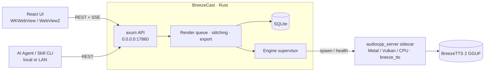

<div align="center">


# BreezeCast

**An AI podcast studio that runs entirely on your machine**

**English** · [简体中文](README.zh-CN.md)

Write a multi-speaker script and produce a full podcast episode with [BreezeTTS 2](https://huggingface.co/BreezeBlue/Breeze-TTS-2): design voices, clone voices, direct the delivery of every line, then export audio with subtitles and chapters.


[Features](#-features) · [Quick Start](#-quick-start) · [Usage](#-usage) · [API & Agents](#-api--agents) · [Architecture](#-architecture) · [License](#-license)

</div>

---

## What is BreezeCast

BreezeCast is a macOS / Windows desktop app that wraps the open-weight speech model BreezeTTS 2 into a complete podcast production tool:

- **Fully offline**: the model runs on your computer through [audio.cpp](https://github.com/0xShug0/audio.cpp) (ggml; Metal on macOS, Vulkan or CPU on Windows). Your text and voices are never uploaded to any server.
- **Built for whole episodes**: not just "type a sentence, get a clip". Manage shows and episodes, script conversations between multiple hosts, edit a single line and regenerate only that line, then mix and export automatically.
- **Designed for AI agents**: every feature in the UI is exposed through a local REST API. With the bundled Skill installed, agents such as Claude Code and Codex can write the script, pick voices, and generate and export the podcast for you.

It is aimed at creators and developers who make Chinese/English podcasts, audio content, or voice-over samples, or who want AI agents to produce audio content automatically.

## 📸 Screenshots

<p align="center">
  
  
</p>
<p align="center"><sub>Left: the library, for managing shows and episodes　·　Right: the episode editor, for editing each line's text, speaker and direction</sub></p>

> The app UI is available in Simplified Chinese and English. Switch language at any time with the selector at the bottom of the sidebar; the choice is remembered, and the first launch follows your system language. See [docs/i18n.md](docs/i18n.md) for how to add a language.

## ✨ Features

| Module | What it does |
|---|---|
| **Shows / episode editor** | Write multi-speaker dialogue as a script; edit each line's text, direction, pauses and vocal events; re-roll a line or lock its random seed; regenerate only the lines you changed; automatic loudness normalization and mixing; export M4A / WAV, SRT subtitles, chapter JSON and transcript |
| **Instant speech** | Real-time streaming playback (first audio in about 0.2–1 s on an M5 chip) or whole-clip generation; every sampling parameter is adjustable; any history entry can be saved as a voice |
| **Voice design** | Create a brand-new voice from a text description or a combination of attribute tags; generate several candidates at once and save the best as a fixed voice |
| **Voice cloning** | Read-along recording (transcript filled in automatically) or import WAV / MP3 / M4A / AIFF / FLAC / OGG; audition the clone before saving; requires confirming the speaker's consent |
| **Voice library** | Manage reference audio, default directions and per-voice parameters; type a direction to audition it |
| **Models & engine** | One-click download (resumable, SHA-256 verified) and switching between Q4_0 / Q4_K / Q8_0 / BF16; BF16 reference-precision toggle; keep-in-memory setting; engine logs |
| **API & agents** | REST API that starts with the app and is reachable from other devices on the LAN; automatic discovery file; one-click Skill install for Claude Code / Codex / oh-my-pi |

Supported vocal events: Chinese `[笑]` `[叹气]` `[咳嗽]` `[清嗓子]`, English `(laugh)` `(sigh)` `(cough)` `(clears throat)`. Mixed Chinese/English text is supported.

## 💻 System Requirements

| Item | macOS | Windows |
|---|---|---|
| OS | macOS 14 Sonoma or later; macOS 26+ shows the Liquid Glass icon | Windows 10 1903 or later / Windows 11, x64 |
| Inference | Apple Silicon (M1 or later), Metal | GPUs with a Vulkan driver (NVIDIA / AMD / Intel) use Vulkan; otherwise falls back to CPU (much slower) |
| Memory | 16 GB or more recommended (the Q8_0 model uses about 3.7 GB once loaded) | Same; with Vulkan, 6 GB or more VRAM recommended |
| Disk | 3.8–7.3 GB per model, see below | Same |

| Model | Size | Notes |
|---|---|---|
| Q4_0 | 3.8 GB | Smallest |
| Q4_K | 4.5 GB | Balance of size and quality |
| **Q8_0** | **5.1 GB** | **Recommended default** |
| BF16 | 7.3 GB | Reference precision |

On Windows, M4A export relies on the built-in Media Foundation. Windows N / KN editions must install the "Media Feature Pack" first; otherwise only WAV export is available.

## 🚀 Quick Start

Prebuilt installers are on [Releases](https://github.com/linyqh/BreezeCast/releases): download the `.dmg` for macOS (signed and notarized) or `*-setup.exe` for Windows (unsigned; if SmartScreen blocks it, click "More info → Run anyway").

To build from source:

**1. Set up the toolchain**

- All platforms: [Rust](https://rustup.rs), Node.js 22+, [pnpm](https://pnpm.io)
- macOS: Xcode Command Line Tools. If cmake is missing, the build script installs a copy under `.tools/`.
- Windows: Visual Studio 2022 Build Tools ("Desktop development with C++"), [Vulkan SDK](https://vulkan.lunarg.com) (set `VULKAN_SDK` after installing), Git

**2. Build and run**

```bash
git clone https://github.com/linyqh/BreezeCast.git
cd BreezeCast
pnpm install
scripts/build-engine.sh        # macOS: build the audio.cpp engine (Metal, breeze_tts only)
pnpm tauri dev                 # run in development mode
```

On Windows, replace line 4 in PowerShell with:

```powershell
.\scripts\build-engine.ps1     # Vulkan build (with CPU fallback); add -Backend cpu without the Vulkan SDK
```

Package:

```bash
pnpm tauri build               # .app / .dmg on macOS, NSIS installer on Windows; output in src-tauri/target/release/bundle/
```

The audio.cpp revision is pinned in `scripts/audiocpp.rev`; both platform build scripts fetch that commit when `vendor/audio.cpp` does not exist.

**3. Download a model**

After the first launch, open "Models & Engine" (模型与引擎) in the sidebar and download a model (Q8_0 recommended). Once the download finishes and the engine shows "ready" (引擎就绪), you are good to go.

### Releasing a new version

The Windows installer is built on GitHub Actions (`.github/workflows/release-windows.yml`); the macOS installer is built locally and uploaded. Both go into the same Release:

1. Bump the version in `src-tauri/tauri.conf.json`, `package.json` and `src-tauri/Cargo.toml`, and commit.
2. Tag and push: `git tag v0.2.0 && git push origin main v0.2.0`. CI builds the Windows engine, runs the Rust tests, produces `BreezeCast_0.2.0_x64-setup.exe`, and uploads it to the `v0.2.0` Release (creating a draft if it doesn't exist). The tag must match the version in `tauri.conf.json`, or CI fails.
3. On a Mac, run `scripts/release-macos.sh` to build the `.dmg` and upload it to the same Release. Add `--skip-build` to upload existing artifacts only, or `--publish` to publish the draft after uploading.

You can also run `release-windows` manually from the Actions page: fill in a tag to upload to that Release, or leave it empty to produce a downloadable artifact only.

## 📖 Usage

### Write an episode as a script

Create an episode under "Shows" (节目) and paste a script like this:

```text
# Episode 1: The Story of Sound
主持人: [笑] 欢迎收听《声波漫谈》。
嘉宾 {轻声，带点犹豫}: 嗯……其实我一开始也不太确定。
<pause 1.5s>
Host {excited, fast}: (laugh) That's amazing!
```

| Syntax | Meaning |
|---|---|
| `Speaker: line` | One line of dialogue; the colon may be `:` or `：` |
| `Speaker {direction}: line` | Adds a direction (tone, emotion, pace) to this line only |
| `<pause 1.5s>` / `<pause 800ms>` | On its own line, inserts silence after the previous line |
| Line without a speaker prefix | Continues the previous speaker |
| `# Title` | Lines starting with `#` and a space are titles or comments and are not spoken |

Then assign a voice from the library to each speaker and click generate. After that, editing any line regenerates only that line.

### Create or clone a voice

- **Voice design**: write a description such as "a middle-aged male radio host with a warm voice and a slightly slow pace", generate a few candidates, and save the one you like best.
- **Voice cloning**: record 3–20 seconds of clean speech, or import an audio file with an accurate transcript. You must obtain the speaker's consent before cloning someone else's voice.

## 🤖 API & Agents

The BreezeCast UI itself runs on the local REST API, so an agent can do everything the UI can.

- Local address: `http://127.0.0.1:17860` (the port can be changed in the app); the LAN address is shown on the "API & Agent" (API 与 Agent) page.
- The running app writes `~/Library/Application Support/com.breezecast.studio/api.json`, which lets local agents find it automatically.
- Full API reference: [docs/API.md](docs/API.md). At runtime, `GET /api/v1/capabilities` returns a machine-readable capability description.

### Install the Skill

Click "Install" on the app's "API & Agent" page, or run:

```bash
scripts/install-skills.sh              # symlink into Claude Code / Codex / oh-my-pi
scripts/install-skills.sh --uninstall  # remove
```

The Skill lives in [skills/breezecast](skills/breezecast/SKILL.md) and ships with a dependency-free Python CLI:

```bash
BC="python3 skills/breezecast/scripts/breezecast.py"
$BC status
$BC episode-create --title "Episode 1" --script-file ep.txt --cast 'Host=Alex'
$BC render e_xxx --wait
$BC export e_xxx --format m4a
```

> [!WARNING]
> The API has no authentication and listens on all network interfaces: anyone on the same LAN can call every endpoint, including deleting data and exporting files to arbitrary directories. Only run BreezeCast on trusted networks.

## 🏗 Architecture



- **Frontend**: React + TypeScript + Vite in the Tauri WebView (WKWebView on macOS, WebView2 on Windows), styled after native macOS (floating glass sidebar, system accent color, light/dark mode); Windows uses the native title bar and an opaque background.
- **Backend**: Rust (Tauri 2 + axum) handles the API, render queue, audio stitching/mixing and export; data is stored in SQLite.
- **Inference engine**: `audiocpp_server` built from audio.cpp, running as a sidecar process. A single streaming session serves both streaming and whole-clip requests, so the model is loaded only once. macOS always uses Metal; on Windows, `--list-devices` is probed at startup, preferring CUDA / Vulkan GPUs and falling back to CPU.
- **Data directory**: `~/Library/Application Support/com.breezecast.studio/` on macOS, `%APPDATA%\com.breezecast.studio\` on Windows; contains models, voices, clips, episodes, the SQLite database and `api.json`.

### Project layout

```text
src/                 React frontend
src-tauri/           Rust backend and Tauri config
  icons/             App icons (macOS .icon / .icns, Windows .ico)
skills/breezecast/   Agent Skill and CLI
scripts/             Engine build (.sh / .ps1), macOS release, icon build, Skill install
.github/workflows/   Windows cloud packaging
docs/API.md          REST API reference
```

### App icon

macOS 26+ uses `Assets.car`, precompiled from `src-tauri/icons/AppIcon.icon` (Liquid Glass); earlier macOS versions use `icon.icns`; Windows uses `icon.ico` and `Square*Logo.png`. After editing `AppIcon.icon`, run `scripts/build-icon.sh` to regenerate `Assets.car`.

## 📄 License

BreezeCast follows the licensing of the upstream [Breeze TTS](https://github.com/breezeblue-ai/breeze-tts) project:

- **Source code**: this project's code is licensed under the [Apache License, Version 2.0](LICENSE).
- **Model and generated audio**: BreezeTTS 2 model weights, checkpoints, derivative models, and all audio you generate locally with them are governed separately by the [BreezeBlue Research and Non-Commercial License](https://huggingface.co/BreezeBlue/Breeze-TTS-2/blob/main/LICENSE) and are **for research and non-commercial use only**. The Apache License does not grant any right to use the model commercially.
- **Third-party code**: the inference engine [audio.cpp](https://github.com/0xShug0/audio.cpp) is licensed under Apache-2.0. Third-party components remain subject to their respective licenses.
- **Responsible use**: you are responsible for complying with applicable laws and obtaining all necessary rights and consents for inputs, reference audio, voices and outputs. Unauthorized voice cloning, impersonation, fraud and other unlawful or harmful uses are prohibited.

## 🙏 Acknowledgements

- [BreezeTTS 2](https://huggingface.co/BreezeBlue/Breeze-TTS-2): bilingual Chinese/English speech model released by BreezeBlue
- [audio.cpp](https://github.com/0xShug0/audio.cpp): local audio model inference built on ggml
- [Tauri](https://tauri.app): cross-platform desktop app framework
